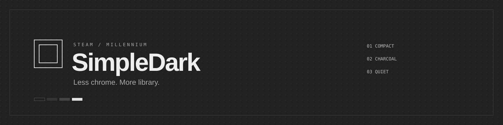
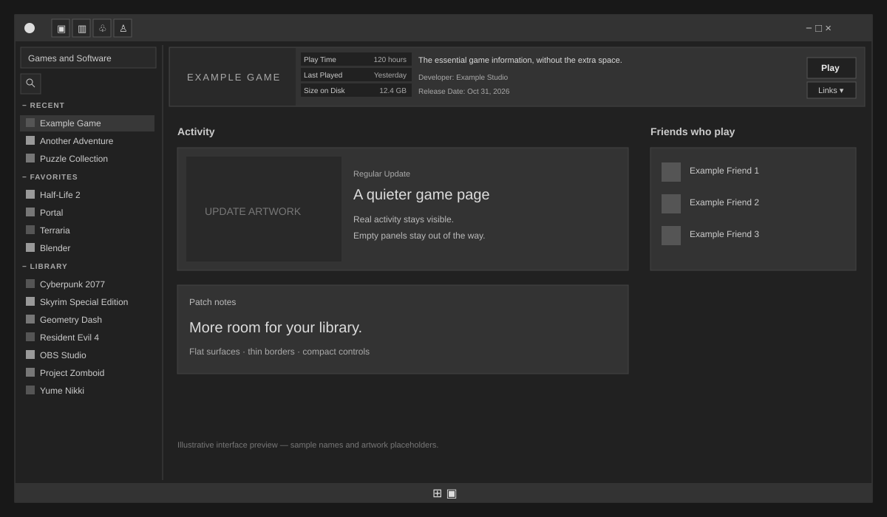

  
  
  

A compact, flat gray Steam interface. Built around your library, with less padding and fewer distractions.

Illustrative preview rendered with sample content. Game artwork and account information are placeholders.

## Small details. More space.

| Area | SimpleDark treatment |
| --- | --- |
| Navigation | Small Store, Library, Community, and Profile icons with tooltips |
| Account | Avatar first; nickname and balance slide out on hover |
| Library | Narrow 190px sidebar, tighter rows, smaller shelf covers |
| Search | Magnifying-glass button that expands on focus |
| Game page | One 80px card with artwork, stats, Play/Install, and Links |
| Activity | Real posts remain; posting prompts and empty feed panels are hidden |
| Footer | Icon buttons, with idle download summaries removed |
| Login | Compact account selection, a dark drifting halftone background, and a white transparent loading GIF |
| Menus | Square corners, 1px outlines, and compact Settings/Properties spacing |

**Palette:** `#212121` canvas · `#333333` panels · `#444444` borders · `#e0e0e0` text.

## Install

1. Install [Millennium](https://steambrew.app) for Steam.
2. [Download SimpleDark.zip](https://github.com/Darkenl/SimpleDark/raw/refs/heads/main/SimpleDark.zip).
3. Extract the **SimpleDark** folder into your Steam theme directory: `Steam/millennium/themes/`.
4. Select **SimpleDark** in Millennium's theme settings. Allow the theme's CSS and JavaScript patches.
5. Restart Steam so the main window, login screen, and secondary windows load the theme.

The extracted folder should contain `skin.json` directly. Avoid a duplicate `SimpleDark/SimpleDark/` folder.

## Customize

- **Colors and font:** `css/universal.css`
- **Navigation, sidebar, and density:** `css/client/compact.css`
- **Account hover animation:** `css/client/navbar.css`
- **Game card:** `css/library/gamepage.css` and `js/gamepage.js`
- **Login appearance:** `login.custom.css`
- **Account-picker/loading sizes:** `js/login-compact.js`
- **Account-switch spinner:** `shutdown-spinner.css` and `js/shutdown-spinner.js`

The login artwork and loading GIF are embedded so they can load without a third-party image request. Original assets are included in `assets/`.

## Compatibility and recovery

Designed for the desktop Steam client with Millennium and JavaScript injection. Steam updates can change CSS classes and break individual tweaks. This is an unofficial Steam customization, not a Valve product.

Syntax and isolated Chromium behavior checks have been run for the custom controls. Those checks do not replace testing every Steam route, account state, or future client version. See [testing notes](docs/TESTING.md).

If a client update breaks the theme, switch to Steam's default theme in Millennium and restart. When reporting an issue, include your Steam and Millennium versions and a screenshot with private information hidden.

## Credits

- **MapleAtMorning:** [OldSteam-Theme](https://github.com/MapleAtMorning/OldSteam-Theme), the original foundation. Its original README and contributor credits are retained [here](docs/UPSTREAM_README.md).
- **Darkenl:** SimpleDark's charcoal palette, compact layout, game-card and navigation customization, and login presentation.
- **Ahm masum:** [Loading icon.gif](https://commons.wikimedia.org/wiki/File:Loading_icon.gif), licensed under [CC BY-SA 4.0](https://creativecommons.org/licenses/by-sa/4.0/). The original GIF is included; a live SVG filter renders it white with a transparent background.
- Halftone login artwork supplied for this customization. See [asset and source notices](NOTICE.md).
